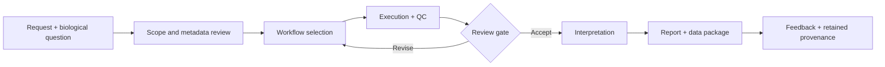

## Operating model

As team lead, I connect technical execution with project communication: clarify the biological question, select the analysis profile, monitor quality, review interpretation, and package a result that can be traced back to inputs and parameters.



## Analysis delivery and technical support

- Delivered genome assemblies, annotations, strain comparisons, microbiome reports and transcriptome count/coverage results for research questions.
- Prepared interpretable reports and data files, with client/internal-researcher discussion of results, additional analyses and reanalysis requirements.
- Maintained automated result conversion, functional-annotation outputs and phylogenetic/visual reporting.

## Internal service operations and management

- Assigned analyses, managed schedules and result review, and maintained SOPs, turnaround and quality controls.
- Investigated analysis-environment, result and report issues; coordinated technical responses, follow-up actions and result redelivery.
- Reviewed chromosome, contig and unplaced-sequence records and provided NCBI submission-related technical support.

Retained communications and delivered outputs support these examples. No complete lifetime workload total is inferred from email or order-code mentions. The [detailed experience record]() also covers technical-listing materials, training and infrastructure.

## What is standardized

- Required metadata and input checks before compute starts
- Environment and parameter capture for reproducibility
- Technical quality gates before biological interpretation
- Structured review and deliverable packaging
- A feedback path for reruns, clarification, and retained provenance

## Boundary

The shared platform has four execution profiles: 16S, ITS, WGS and hybrid assembly. RNA and other research analyses are broader service work, not additional profiles of that platform. Gene-count delivery does not establish completed differential-expression or enrichment analysis; external RNA QC and method evaluation do not establish regulatory qualification or therapeutic efficacy.
