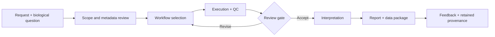

## Operating model

As team lead, I connect technical execution with project communication: clarify the biological question, select the analysis profile, monitor quality, review interpretation, and package a result that can be traced back to inputs and parameters.



## Representative analysis and delivery evidence

- Curated complex WGS/hybrid contigs by reviewing Bandage graphs, BLAST and short/long-read depth together; delivered revised reports and assembly-graph/BUSCO technical responses.
- Delivered ANI, AMR, virulence-factor and MLST comparisons, plus panX core-gene comparisons and SVG/Newick trees.
- Produced featureCounts gene-count and alignment summaries and RNA reference depth/coverage results.
- Updated the eggNOG report script to include missing functional categories, orthology and pathway outputs.
- Tested Nanopore Dorado modes and duplex QC and prepared analysis/panX manuals, execution-environment guidance and staff training.

These examples link retained communications with concrete analytical outputs. No complete lifetime workload total is inferred from email or order-code mentions.

## What is standardized

- Required metadata and input checks before compute starts
- Environment and parameter capture for reproducibility
- Technical quality gates before biological interpretation
- Structured review and deliverable packaging
- A feedback path for reruns, clarification, and retained provenance

## Boundary

The shared platform has four execution profiles: 16S, ITS, WGS and hybrid assembly. RNA and other research analyses are broader service work, not additional profiles of that platform. Gene-count delivery does not establish completed differential-expression or enrichment analysis; external RNA QC and method evaluation do not establish regulatory qualification or therapeutic efficacy.
