## Wittgenbio research scope

At **Wittgenbio** (July 1 – October 1, 2026), I built a **colorectal cancer (CRC) single-cell atlas** and performed **cell-type annotation**. I also annotated externally supplied normal-tissue atlas data and compared tissue-specific expression. The separate virtual-cell research track is described below.

## CRC single-cell atlas workflow



The atlas workflow integrates measured single-cell datasets and reviews their metadata, cell quality, study differences, and cell-type labels. Annotation consistency and tumor/normal label discrepancies remain traceable to the source data.

## Normal-tissue atlas annotation and expression analysis

I performed cell-type annotation on externally supplied normal-tissue atlas data and compared tissue-specific expression. Candidate therapeutic targets were evaluated against normal-tissue expression while accounting for sequencing-depth differences and annotation coverage.

## Virtual-cell workflow

```mermaid
flowchart LR
    cellular_data[Cellular and molecular data] --> data_model_scope[Data and modeling scope]
    biological_question[Biological question] --> data_model_scope
    data_model_scope --> cell_representation[Computational cell representation]
    cell_representation --> train_evaluation_design[Train and evaluation design]
    train_evaluation_design --> virtual_cell_model[Virtual-cell model]
    virtual_cell_model --> state_response_evaluation[State and response evaluation]
    state_response_evaluation --> biological_review[Biological plausibility review]
    biological_review --> research_hypotheses[Research hypotheses]
    class data_model_scope,cell_representation,train_evaluation_design,virtual_cell_model,state_response_evaluation,biological_review project-tool-node
```



The virtual-cell track focuses on whether a computational representation preserves biologically useful cell-state information and whether predicted states or responses remain reliable outside the data used to build the model.

## Evaluation principles

- Separate model fitting from evaluation data and document reference or condition coverage.
- Compare predictions with measurable biological signals rather than relying on latent-space appearance alone.
- Report where cell types, states, tissues, perturbations, or experimental conditions are underrepresented.
- Treat generated cell states and perturbation responses as hypotheses until they are externally or experimentally validated.

## Boundary

Cell-type annotations and normal-tissue expression comparisons depend on data quality, annotation coverage, and biological context. Virtual-cell predictions do not establish biological mechanism or treatment response without independent data and experimental validation.
