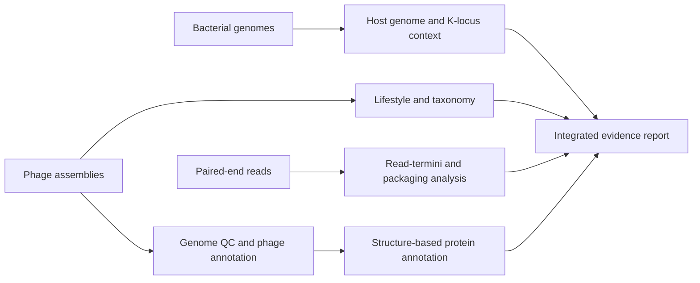
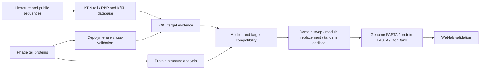

## Current-role scope

At MicrobiotiX, my work covers bacterial/phage genome analysis, RBP candidate design, reference and prediction software, and technical support for analysis and developer integration. I contribute to cocktail-selection software and verify combination calculations against measured host-range data. The anonymized report case and separately checked reference/benchmark evidence below retain their original evaluation scope.

## Design bench

<figure class="project-result-figure">
  
  <figcaption><strong>Sanitized static excerpt of the supplied design bench.</strong> The phage–capsule interaction scene is retained while internal genome and reference identifiers are removed. Genome evidence, capsule-target tail/RBP references, anchor compatibility, and protein-structure support are evaluated together before a module-replacement candidate advances to wet-lab testing.</figcaption>
</figure>

## What the bench evaluates

| Evidence layer    | Concrete analysis                                                     | Decision supported                                          |
| ----------------- | --------------------------------------------------------------------- | ----------------------------------------------------------- |
| Phage genome      | Assembly QC, taxonomy, lifestyle and read-termini review              | Select a lytic, structurally characterized chassis          |
| Host genome       | _K. pneumoniae_ assembly and K-locus typing                           | Define the capsule target independently of the phage call   |
| Tail/RBP database | Separate K-serotype/KL-locus labels, provenance and sequence coverage | Identify candidate receptor-binding or depolymerase modules |
| Protein structure | Domain-boundary review, Foldseek/PDB support and fold retention       | Reject candidates likely to disrupt attachment or folding   |
| Design gate       | Anchor identity/coverage, genus context and label consistency         | Rank domain swap, module replacement or tandem addition     |

## Analysis, development and technical support

- Performed genome comparisons and RBP candidate analyses to prepare assessment reports, candidate sequences and sequence/structure comparison records.
- Built capsule-target references and prediction libraries and contributed to cocktail-selection software and calculation verification.
- Provided analysis-software technical support and prepared developer specifications, examples, result formats and reproduction records, with source and installed-package execution checks.

## Genome evidence workflow



The workflow keeps independent evidence streams separate until integration. Taxonomy combines nearest-neighbor and graph-clustering evidence; lifestyle combines hallmark-gene review with two machine-learning approaches; packaging is determined from raw-read termini rather than inferred from terminase annotation alone.

## Tail, capsule-type, and structure-design workflow



## Reference resource and evaluation evidence

| Checked artifact or protocol                       | Recorded result                                      | Interpretation                                                |
| -------------------------------------------------- | ---------------------------------------------------- | ------------------------------------------------------------- |
| Collected tail/RBP sequences                       | 7,759 rows in 5,467 clusters                         | Collection and clustering; experimental labels cover a subset |
| K-type labels                                      | 442 label-bearing rows; 62 distinct labels           | Rows and label types are different units                      |
| Literature-backed experimental K labels            | 107 rows                                             | Kept separate from inferred labels                            |
| Measured host-range input                          | 221 bacterial strains × 74 phages                    | Dataset dimensions for candidate-combination comparisons      |
| KL-specific design tables                          | 446 part rows; 627 ranked entries; 800 evidence rows | Searchable candidate and evidence records                     |
| 110-query benchmark, exclude query alone           | Correct-label inclusion 85/110 (77.3%)               | At least one true target label included                       |
| Same 110-query benchmark, exclude sequence cluster | Correct-label inclusion 48/110 (43.6%)               | Same inclusion metric with related-sequence evidence withheld |
| 80–90% identity subset, query-alone exclusion      | Base-label hit 0/4                                   | Original base-label metric; small mode-specific subset        |
| 80–90% identity subset, cluster exclusion          | Base-label hit 3/17                                  | Original base-label metric; a different mode-specific subset  |

The benchmark is a saved reference snapshot with 110 queries per mode, evaluated by inclusion of at least one correct target label; it is not external validation. Its record correspondence to the current 107 literature-backed experimental K-label rows has not been established. The two 80–90% rows use the original benchmark's single base-label metric, not the inclusion metric above; their different, small subsets do not establish a general failure interval. Archived model-development and cross-validation records document label-imbalance and data-overlap concerns and the decision to defer an additional predictor.

## Results highlighted from the report

- In an anonymized four-genome study, independent evidence converged on **lytic Przondovirus** genomes with **short DTR packaging** and 180-183 bp terminal repeats.
- Assigned three capsule targets with **95.4-98.8% sequence identity** to experimentally supported references while retaining unresolved targets as data gaps instead of forcing labels.
- Used independent protein-language-model classifiers to distinguish structural tail proteins from candidate depolymerases, then checked the calls with sequence, domain, and structure evidence.
- Used **ProstT5 and Foldseek** with experimental PDB references to detect conserved folds at sequence identities too low for ordinary sequence search and to review catalytic-domain boundaries.
- Prioritized an engineering candidate using same-genus context, a **129-aa anchor alignment spanning 99.2% of the region**, experimental structure support, label-consistency checks, and predicted structural retention. This supported a **module-replacement hypothesis** for a K64-targeting construct rather than a claim of experimental host-range expansion.

## Boundary

The database and design bench prioritize testable hypotheses. The 100% design display is the upper limit of a capped evaluation score, not an experimental success probability. KL-type prediction should be checked against host-genome evidence such as Kaptive results, and predicted RBP folding, adsorption, host range, and lytic activity still require wet-lab validation.
